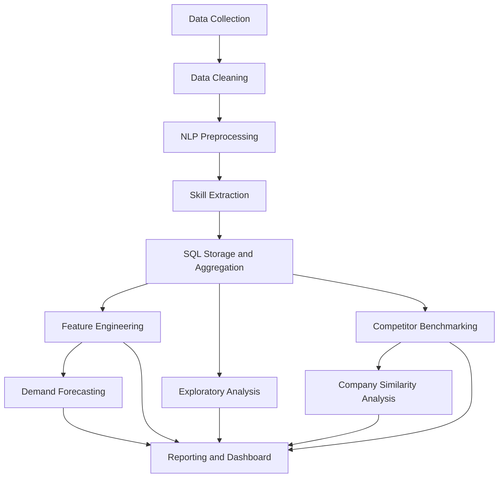

# Competitor Demand Prediction Using Job Postings

## Objective

This project aims to analyze and forecast competitor hiring demand and skill requirements using publicly available job posting data. By tracking job listing frequencies, extracting technical and soft skill sets, and modeling hiring patterns over time, the system enables organizations to anticipate competitor talent expansion, technological pivots, and workforce capacity trends.

## Target Scope

- **Core Project Scope (Sprints 1–7):** Microsoft-only analysis (`company_name == "Microsoft"`), covering 498 validated job postings across 52 active ISO weeks in 2023.
- **Competitor Benchmarking (Sprint 8):** Extended comparison of Microsoft, Amazon, IBM, Accenture, and Deloitte using the original 2023 dataset.
- **Company Similarity (Sprint 10):** Comparison of the five selected companies using their skill-demand profiles.
- **Demand Forecasting (Sprint 9):** Microsoft-only weekly job-posting demand forecasting.
- **Entity Definition:** Strict company-name matching for the five selected companies.
- **Dataset Source:** Luke Barousse Data Jobs dataset.
- **Selected Competitor Postings:** 6,450 records across the five companies.
- **Geographical Analysis:** Global comparison and a separate India-focused analysis.

---

## Technology Stack

- **Language:** Python (>= 3.9)
- **Data Manipulation & Math:** Pandas, NumPy
- **Machine Learning:** scikit-learn
- **Natural Language Processing:** NLTK, spaCy
- **Visualization:** Matplotlib, Plotly
- **Database & Querying:** SQL (SQLite via `sqlite3` / SQLAlchemy)
- **Testing & Quality Assurance:** pytest
- **Reporting & Dashboard:** Streamlit

---

## Data Source & Setup

The primary data source is the publicly available [Luke Barousse Data Jobs repository](https://github.com/lukebarousse/data_jobs).

> [!IMPORTANT]
> Raw datasets and most processed data are excluded from Git via `.gitignore`. Named Microsoft processed CSV deliverables, including `microsoft_jobs_skills.csv`, are explicitly allowed and eligible for Git tracking.

To configure the dataset locally:

1. Download `data_jobs.csv` from the source repository.
2. Place the file at:

```text
data/raw/data_jobs.csv
```

An optional NLP benchmark dataset, `fake_job_postings.csv`, can also be placed in `data/raw/` if using text-classification benchmarks.

---

## Quickstart

### 1. Environment Setup

Clone the repository and set up a Python virtual environment:

```bash
# Windows
python -m venv .venv
.venv\Scripts\activate

# macOS / Linux
python3 -m venv .venv
source .venv/bin/activate
```

### 2. Install Dependencies

```bash
pip install -r requirements.txt
```

---

## Running Project Pipelines

All pipelines are designed to be executed from the repository root.

### Sprint 1: Data Ingestion & Target Filtering

Loads raw postings, filters strictly to Microsoft (`company_name == 'Microsoft'`), validates schema constraints, and exports the target slice.

```bash
python src/collection/collector.py
```

- **Input:** `data/raw/data_jobs.csv`
- **Output:** `data/processed/microsoft_jobs.csv` (498 records, 17 columns)
- **Validation Report:** `reports/dataset_validation_report.md`

### Sprint 2: Data Cleaning, Imputation & Date Normalization

Standardizes company casing, parses timestamps into temporal attributes, annualizes compensation metrics, parses serialized skill arrays, normalizes location hubs, and imputes missing categories.

```bash
python src/preprocessing/cleaner.py
```

- **Input:** `data/processed/microsoft_jobs.csv`
- **Output:** `data/processed/microsoft_jobs_cleaned.csv` (498 records, 32 columns)
- **Sprint Report:** `reports/sprint_02_report.md`

### Sprint 3: NLP Preprocessing Pipeline

Normalizes job title text, tokenizes and lemmatizes role terms, removes English and domain-specific stop words, preserves technical languages such as C#, C++, SQL, and Python, normalizes skill names, and deduplicates skills per job.

```bash
python src/preprocessing/nlp_pipeline.py
```

- **Input:** `data/processed/microsoft_jobs_cleaned.csv`
- **Output:** `data/processed/microsoft_jobs_nlp.csv` (498 records, 35 columns)
- **Sprint Report:** `reports/sprint_03_report.md`

### Sprint 4: NER and Skill Extraction Pipeline

Applies spaCy-based Named Entity Recognition (ORG, GPE, PERSON, LOC, PRODUCT) and deterministic skill extraction using `PhraseMatcher` and token-level `Matcher`. Normalizes technical skill variants, groups competencies into eight structured categories, deduplicates skills, and serializes annotations to JSON.

```bash
python src/skills/extractor.py
```

- **Input:** `data/processed/microsoft_jobs_nlp.csv`
- **Output:** `data/processed/microsoft_jobs_skills.csv` (498 records, 40 columns)
- **Sprint Report:** `reports/sprint_04_report.md`

**NER limitation:** The source dataset does not contain full narrative job descriptions. The pipeline therefore uses a composite text representation based on available structured fields when descriptions are unavailable. This includes `Company: Microsoft`; consequently, Microsoft being labeled `ORG` in all 498 rows is a consistency check, not evidence that NER is accurate. Extracted `PERSON` labels are model detections and may include false positives; they are not verified real people.

### Sprint 5: Database Storage & SQL Analysis

Implements a normalized SQLite database for storing Microsoft job postings, extracted skills, skill categories, and named entities. The database manager supports schema initialization, structured data loading, read-only SQL queries, and table-count inspection.

**Database initialization and loading example:**

```python
import pandas as pd
from src.database.db_manager import DatabaseManager

manager = DatabaseManager(
    db_path="data/database/readme_example.db"
)
manager.initialize_database()

df = pd.read_csv("data/processed/microsoft_jobs_skills.csv")
stats = manager.load_dataframe(df)

print(stats)
print(manager.get_table_counts())
```

- **Input:** `data/processed/microsoft_jobs_skills.csv`
- **Database:** `data/database/competitor_demand.db`
- **Schema:** `sql/schema.sql`
- **Analysis Queries:** `sql/competitor_queries.sql`, `sql/trend_queries.sql`
- **Sprint Report:** `reports/sprint_05_report.md`
- **Validation:** 20/20 SQL queries passed; database integrity and foreign-key checks passed.

> **Important:** Database loading is a one-time operation for a populated database. The loader rejects duplicate loads rather than overwriting existing job postings. Use a fresh database path when performing a new import.

### Sprint 6: Feature Engineering

Creates time-based demand features, rolling averages, weekly skill-demand records, company-skill frequency matrices, and hiring-velocity indicators.

- `src/features/feature_builder.py` — Feature engineering implementation.
- `tests/test_feature_builder.py` — Feature engineering tests.
- `data/processed/weekly_demand_features.csv` — 52 weekly demand observations with 12 columns.
- `data/processed/weekly_skill_demand.csv` — 801 weekly skill-demand records covering 47 unique skills.
- `reports/sprint_06_report.md` — Sprint implementation and validation report.

**Validation:** 498 job postings accounted for, with no duplicate weeks or week-skill pairs.

### Sprint 7: Exploratory Analysis and Demand Insights

Analyzes job-role demand, geographic distribution, work arrangements, employment types, salary distribution, skill demand, and weekly skill trends.

- `src/analysis/exploratory_analysis.py` — Exploratory analysis implementation.
- `tests/test_exploratory_analysis.py` — Automated analysis tests.
- `outputs/sprint_07/` — Eight CSV analysis outputs and seven PNG visualizations.
- `reports/sprint_07/demand_insights.md` — Sprint demand insights report.

**Validation:** Analysis outputs were verified against the report, and 260 weekly skill-trend records were generated.

### Sprint 8: Competitor Benchmarking

Compares five selected companies: Microsoft, Amazon, IBM, Accenture, and Deloitte. Analysis includes skill demand, job-role distribution, country-level comparisons, and India-focused benchmarking.

- `src/analysis/competitor.py` — Competitor data loading, skill-demand analysis, role comparison, and country comparison.
- `src/analysis/competitor_visualizer.py` — Generates global and India-focused comparison charts.
- `tests/test_competitor.py` — Competitor-analysis tests.
- `outputs/sprint_08/` — Seven CSV analysis outputs and five PNG visualizations.
- `reports/sprint_08_report.md` — Sprint implementation, findings, and validation report.

**Validation:** 6,450 selected company postings analyzed, including 816 India postings. Five visualizations and seven CSV outputs generated.

### Sprint 9: Weekly Demand Forecasting

Implements Moving Average, Linear Regression, and Ridge Regression models to forecast weekly Microsoft job-posting demand. Models are evaluated using chronological validation and error metrics.

- `src/modeling/forecasting.py` — Weekly demand forecasting implementation.
- `tests/test_forecasting.py` — Forecasting tests.
- `outputs/sprint_09/model_comparison.csv` — Evaluation metrics for three forecasting models.
- `outputs/sprint_09/future_demand_forecast.csv` — Four-week forecasts from the three models.
- `outputs/sprint_09/model_comparison.png` — Model evaluation comparison.
- `outputs/sprint_09/future_demand_forecast.png` — Historical demand and future forecast visualization.
- `reports/sprint_09_report.md` — Implementation, results, and limitations.

**Validation:** 52 weekly Microsoft demand observations analyzed. Moving Average achieved the lowest MAE (5.050) and RMSE (6.131).

**Forecasting limitation:** Forecasts are illustrative extrapolations from 2023 historical job postings and should not be interpreted as current hiring predictions.

### Sprint 10: Company Similarity Analysis

Measures similarity between the five selected companies based on their skill-demand profiles. Uses company-skill matrices, cosine similarity, Jaccard skill overlap, distance calculations, and clustering to compare hiring-skill patterns.

- `src/modeling/similarity.py` — Company similarity calculations.
- `src/modeling/run_similarity_analysis.py` — Similarity analysis execution.
- `tests/test_similarity.py` — Automated similarity tests.
- `outputs/sprint_10/company_skill_matrix.csv` — Company-skill frequency matrix.
- `outputs/sprint_10/company_similarity_matrix.csv` — Cosine similarity matrix.
- `outputs/sprint_10/company_distance_matrix.csv` — Company distance matrix.
- `outputs/sprint_10/company_skill_overlap.csv` — Skill overlap comparison.
- `outputs/sprint_10/company_clusters.csv` — Company cluster assignments.
- `outputs/sprint_10/similarity_heatmap.png` — Similarity heatmap.
- `outputs/sprint_10/company_dendrogram.png` — Hierarchical clustering dendrogram.
- `reports/sprint_10_report.md` — Implementation, results, and validation report.

**Validation:** Five companies, 180 skills, and 613 company-skill records analyzed. Accenture and Deloitte had the highest cosine similarity (0.9584).

**Interpretation limitation:** Similarity represents overlap in observed skill-demand profiles. It does not establish overall business competition or market-share similarity.

### Sprint 11: Interactive Streamlit Dashboard

Develops an interactive dashboard that brings together the project's analysis, benchmarking, forecasting, and similarity results.

Run the dashboard from the repository root:

```bash
python -m streamlit run dashboard/app.py
```

The dashboard contains four sections:

1. **Project Overview:** Project summary, key metrics, and job-role demand.
2. **Competitor Benchmarking:** Company-level comparison and competitor skill and role analysis.
3. **Demand Forecasting:** Model performance comparison, actual-versus-predicted demand, and future demand forecasts.
4. **Company Similarity:** Cosine similarity heatmap, similarity matrix, skill overlap, company clusters, and dendrogram.

- `dashboard/app.py` — Interactive Streamlit dashboard.
- Dashboard inputs — CSV analysis outputs from Sprints 7–10.
- **Validation:** All four sections and their displayed charts and tables were manually checked. No dashboard runtime errors were observed.

### Sprint 12: Final Integration & Review

Performs final project-level verification, including automated testing, dashboard validation, and documentation review.

- Full automated test suite executed using `python -m pytest -v`.
- **Current test result: 210 passed.**
- Streamlit dashboard opened and all four sections were checked.
- Forecast charts, actual-versus-predicted visualization, future forecast table, similarity matrix, skill overlap, clusters, and dendrogram were verified.
- No dashboard runtime errors were observed.

**Current integration status:** Automated tests and dashboard runtime checks passed. Final documentation and repository review are being completed.

---

## Running Automated Tests

The project includes tests for data collection, filtering, cleaning, salary annualization, skill parsing, location normalization, NLP preprocessing, Named Entity Recognition, deterministic skill extraction, database operations, feature engineering, exploratory analysis, competitor benchmarking, forecasting, and company similarity.

Run the complete test suite:

```bash
python -m pytest -v
```

**Latest verification result: 210 passed.**

---

## Project Stages & 12-Sprint Roadmap

1. **Sprint 1 — Data Collection:** Ingestion, strict company filtering, and validation (**Complete**).
2. **Sprint 2 — Data Cleaning:** Missing-value imputation, date decomposition, salary standardization, and location parsing (**Complete**).
3. **Sprint 3 — NLP Preprocessing:** Text normalization, tokenization, lemmatization, and stop-word filtering (**Complete**).
4. **Sprint 4 — Skill Extraction:** Technical skill and competency extraction using NLP and phrase matching (**Complete**).
5. **Sprint 5 — Database Storage & SQL Analysis:** SQLite schema design, normalized data storage, and SQL-based analysis (**Complete**).
6. **Sprint 6 — Feature Engineering:** Time-lag features, rolling averages, weekly skill demand, and hiring velocity (**Complete**).
7. **Sprint 7 — Exploratory Analysis and Demand Insights:** Job-role demand, geography, work arrangements, employment types, salary, and skill trends (**Complete**).
8. **Sprint 8 — Competitor Benchmarking:** Five-company comparison, skill demand, role distribution, and India-focused analysis (**Complete**).
9. **Sprint 9 — Demand Forecasting:** Moving Average, Linear Regression, and Ridge Regression models with chronological validation (**Complete**).
10. **Sprint 10 — Company Similarity Analysis:** Cosine similarity, Jaccard overlap, company distance, and clustering (**Complete**).
11. **Sprint 11 — Interactive Dashboard:** Streamlit dashboard integrating project overview, benchmarking, forecasting, and similarity analysis (**Complete**).
12. **Sprint 12 — Integration & Final Review:** Automated tests, dashboard validation, and documentation review completed successfully.

---

## Planned Workflow



---

## Project Directory Layout

```text
Competitor Demand Prediction Using Job Postings/
├── data/
│   ├── raw/                   # Raw job postings (ignored by Git)
│   ├── processed/             # Processed datasets
│   └── database/              # SQLite database
├── sql/
│   ├── schema.sql
│   ├── competitor_queries.sql
│   └── trend_queries.sql
├── src/
│   ├── collection/            # Data collection and filtering
│   ├── preprocessing/         # Cleaning and NLP preprocessing
│   ├── skills/                # NER and skill extraction
│   ├── features/              # Feature engineering
│   ├── analysis/              # EDA and competitor analysis
│   ├── modeling/              # Forecasting and similarity analysis
│   └── database/              # Database utilities
├── dashboard/
│   └── app.py                 # Interactive Streamlit dashboard
├── notebooks/                 # Exploratory analysis and experiments
├── outputs/
│   ├── sprint_07/
│   ├── sprint_08/
│   ├── sprint_09/
│   └── sprint_10/
├── reports/
│   ├── dataset_validation_report.md
│   ├── sprint_02_report.md
│   ├── sprint_03_report.md
│   ├── sprint_04_report.md
│   ├── sprint_05_report.md
│   ├── sprint_06_report.md
│   ├── sprint_07/
│   │   └── demand_insights.md
│   ├── sprint_08_report.md
│   ├── sprint_09_report.md
│   └── sprint_10_report.md
├── tests/                     # Automated test suite
├── requirements.txt
└── README.md
```

---

## Current Project Status

- **Sprints 1–11:** Implementation completed.
- **Sprint 12:** Integration, dashboard verification, automated testing, and documentation review completed.
- **Microsoft dataset:** 498 validated job postings across 52 active ISO weeks in 2023.
- **Competitor dataset:** 6,450 selected postings across five companies.
- **Database:** SQLite database with eight application tables.
- **SQL Analysis:** 20/20 queries passed validation.
- **Demand Forecasting:** Three forecasting models evaluated.
- **Company Similarity:** Five companies compared using 180 skills.
- **Dashboard:** Four interactive sections verified.
- **Automated Tests:** 210/210 passing.

## Important Project Limitations

- The core demand analysis and weekly forecasting use Microsoft job postings from 2023.
- Competitor benchmarking and company similarity use the five selected companies.
- Forecasts are based on historical data and are not guaranteed predictions of current hiring demand.
- Company similarity measures skill-demand overlap, not overall business competition.
- NER results are model-generated labels and should not be treated as fully verified entities.
