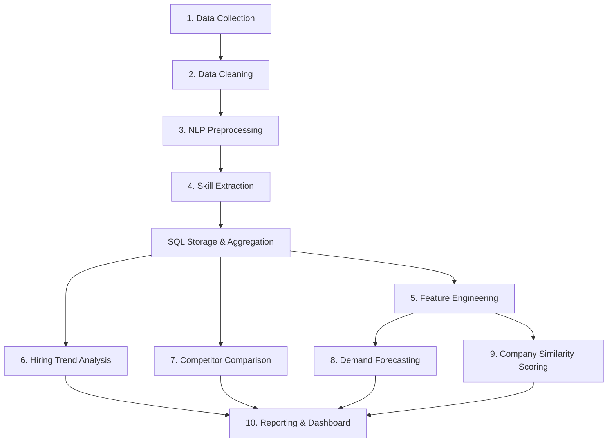

# Competitor Demand Prediction Using Job Postings

## Objective
This project aims to analyze and forecast competitor hiring demand and skill requirements using publicly available job posting data. By tracking job listing frequencies, extracting technical and soft skill sets, and modeling hiring patterns over time, the system enables organizations to anticipate competitor talent expansion, technological pivots, and workforce capacity trends.

### Target Scope
- **Target Company**: **Microsoft ONLY** (`company_name == "Microsoft"`)
- **Entity Definition**: Strict corporate entity matching; recruitment agencies, third-party staffing firms, and non-canonical subsidiaries are excluded.
- **Dataset Scale**: Exactly 498 validated Microsoft job postings spanning the full 2023 calendar year (52 out of 52 active ISO weeks).

---

## Technology Stack
- **Language**: Python (>= 3.9)
- **Data Manipulation & Math**: Pandas, NumPy
- **Machine Learning**: scikit-learn
- **Natural Language Processing**: NLTK, spaCy
- **Visualization**: Matplotlib
- **Database & Querying**: SQL (SQLite via `sqlite3` / SQLAlchemy)
- **Testing & Quality Assurance**: pytest
- **Reporting & Dashboard**: Streamlit / Python-driven reporting

---

## Data Source & Setup

The primary data source is the publicly available [Luke Barousse Data Jobs repository](https://github.com/lukebarousse/data_jobs).

> [!IMPORTANT]
> Raw datasets and most processed data are excluded from Git via `.gitignore`. The named Microsoft processed CSV deliverables, including `microsoft_jobs_skills.csv`, are explicitly allowed and eligible for Git tracking.

To configure the dataset locally:
1. Download `data_jobs.csv` from the source repository.
2. Place the file in the project directory at:
   ```text
   data/raw/data_jobs.csv
   ```
*(Optional NLP benchmark dataset `fake_job_postings.csv` can also be placed in `data/raw/` if utilizing text classification benchmarks).*

---

## Quickstart

### 1. Environment Setup
Clone the repository and set up a clean Python virtual environment:

```bash
# Windows
python -m venv venv
venv\Scripts\activate

# macOS / Linux
python3 -m venv venv
source venv/bin/activate
```

### 2. Install Dependencies
Install all required project and testing dependencies:

```bash
pip install -r requirements.txt
```

---

## Running Project Pipelines

All pipelines are designed to be executed directly from the repository root:

### Sprint 1: Data Ingestion & Target Filtering
Loads raw postings, filters strictly to Microsoft (`company_name == 'Microsoft'`), validates schema constraints (zero null titles, dates, or companies; exact 498 count), and exports the target slice:

```bash
python src/collection/collector.py
```
- **Input**: `data/raw/data_jobs.csv`
- **Output**: `data/processed/microsoft_jobs.csv` (498 records, 17 columns)
- **Validation Report**: `reports/dataset_validation_report.md`

### Sprint 2: Data Cleaning, Imputation & Date Normalization
Standardizes company casing, parses timestamps into 8 temporal attributes (year, month, week, day, day of week, quarter, year-week), annualizes compensation metrics, parses serialized skill arrays into structured lists/dictionaries, normalizes location hubs, and imputes missing categories:

```bash
python src/preprocessing/cleaner.py
```
- **Input**: `data/processed/microsoft_jobs.csv`
- **Output**: `data/processed/microsoft_jobs_cleaned.csv` (498 records, 32 columns)
- **Sprint Report**: `reports/sprint_02_report.md`

### Sprint 3: NLP Preprocessing Pipeline
Normalizes job title text, tokenizes and lemmatizes role terms, removes English and domain-specific stop-words (including seniority levels), preserves technical languages (C#, C++, SQL, Python), normalizes skill names with canonical aliases, deduplicates skills per job, and deserializes Sprint 2 skill lists back into Python objects for downstream analysis:

```bash
python src/preprocessing/nlp_pipeline.py
```
- **Input**: `data/processed/microsoft_jobs_cleaned.csv`
- **Output**: `data/processed/microsoft_jobs_nlp.csv` (498 records, 35 columns)
- **Sprint Report**: `reports/sprint_03_report.md`

### Sprint 4: NER and Skill Extraction Pipeline
Applies spaCy-based Named Entity Recognition (ORG, GPE, PERSON, LOC, PRODUCT) and deterministic skill extraction via `PhraseMatcher` and token-level `Matcher`. Normalizes informal tech variants (e.g., `sklearn` → `Scikit-learn`, `postgres` → `PostgreSQL`, `ms sql server` → `Microsoft SQL Server`), groups competencies into 8 structured categories, deduplicates skills per posting, and serializes structured annotations to JSON:

```bash
python src/skills/extractor.py
```
- **Input**: `data/processed/microsoft_jobs_nlp.csv`
- **Output**: `data/processed/microsoft_jobs_skills.csv` (498 records, 40 columns)
- **Sprint Report**: `reports/sprint_04_report.md`

The source dataset does not contain full narrative job descriptions, so the pipeline uses a composite text representation based on available structured fields when descriptions are unavailable. This includes `Company: Microsoft`; therefore, Microsoft being labeled `ORG` in all 498 rows is only a consistency check, not evidence that NER is accurate. Extracted `PERSON` labels are model detections and may include false positives; they are not verified real people.

---
### Sprint 5: Database Storage & SQL Analysis

Implements a normalized SQLite database for storing Microsoft job postings, extracted skills, skill categories, and named entities. The database manager supports schema initialization, structured data loading, read-only SQL queries, and table-count inspection.

**Database initialization and loading example:**

```python
import pandas as pd
from src.database.db_manager import DatabaseManager

manager = DatabaseManager(
    db_path="data/database/readme_example.db"
)
manager.initialize_database()

df = pd.read_csv("data/processed/microsoft_jobs_skills.csv")
stats = manager.load_dataframe(df)

print(stats)
print(manager.get_table_counts())
```

- **Input**: `data/processed/microsoft_jobs_skills.csv`
- **Database**: `data/database/competitor_demand.db`
- **Schema**: `sql/schema.sql`
- **Analysis queries**: `sql/competitor_queries.sql`, `sql/trend_queries.sql`
- **Sprint Report**: `reports/sprint_05_report.md`
- **Validation**: 20/20 SQL queries passed; database integrity and foreign-key checks passed.

**Important:** Database loading is a one-time operation for a populated database. The loader rejects duplicate loads rather than overwriting existing job postings. Use a fresh database path when performing a new import.

## Running Automated Tests

The project includes unit tests for data collection, filtering, cleaning, salary annualization, skill parsing, location normalization, NLP preprocessing, Named Entity Recognition, deterministic skill extraction, and pipeline integration. Run the test suite using `pytest`:

```bash
python -m pytest -v
```

All 169 automated tests pass across the project, including database tests in `tests/test_database.py`.

---

## Project Stages & 12-Sprint Roadmap

1. **Sprint 1 — Data Collection**: Ingestion, strict competitor filtering, and validation (**Complete**).
2. **Sprint 2 — Data Cleaning**: Missing value imputation, date decomposition, salary standardization, and location parsing (**Complete**).
3. **Sprint 3 — NLP Preprocessing**: Text normalization, tokenization, lemmatization, and stop-word filtering across job titles and descriptions (**Complete**).
4. **Sprint 4 — Skill Extraction**: Extracting domain-specific technical skills, tools, and competencies using dictionary matching and NLP phrase extraction (**Complete**).
5. **Sprint 5 — Database Storage & SQL Analysis**: Relational SQLite schema design, normalized data storage, indexing, and SQL-based Microsoft skill-demand and hiring trend analysis (**Complete**).
6. **Sprint 6 — Feature Engineering**: Creating time-lag features, rolling averages, company-skill frequency matrices, and hiring velocity indicators (*Pending*).
7. **Sprint 7 — Hiring Trend Analysis**: Evaluating temporal hiring trends and volume dynamics across companies and job roles using SQL and Pandas (*Pending*).
8. **Sprint 8 — Competitor Comparison**: Benchmarking competitor profiles, tech stack overlap, and talent acquisition priorities (*Pending*).
9. **Sprint 9 — Demand Forecasting**: Building time-series and regression models (via scikit-learn) to predict future hiring demand by competitor and role (*Pending*).
10. **Sprint 10 — Company Similarity Scoring**: Computing vector similarity (e.g., Cosine Similarity) and clustering competitor profiles based on skill footprint and hiring distributions (*Pending*).
11. **Sprint 11 — Reporting / Dashboard**: Developing visual summaries, Matplotlib charts, and an interactive Streamlit dashboard (*Pending*).
12. **Sprint 12 — Integration & Final Review**: End-to-end pipeline validation, performance tuning, and executive presentation (*Pending*).

---

## Planned Workflow


---

## Project Directory Layout
```text
Competitor Demand Prediction Using Job Postings/
├── data/
│   ├── raw/                  # Raw unprocessed job postings (ignored by Git)
│   ├── processed/            # Processed data (mostly ignored; named Microsoft CSV deliverables are allowed)
│   └── database/             # SQLite database and storage deliverables
├── sql/                      # SQL schema and analysis queries
│   ├── schema.sql
│   ├── competitor_queries.sql
│   └── trend_queries.sql
├── src/                      # Modular Python source code
│   ├── collection/           # Stage 1: Data collection & filtering
│   ├── preprocessing/        # Stages 2 & 3: Data cleaning & NLP pipeline
│   ├── skills/               # Stage 4: Skill extraction
│   ├── features/             # Stage 5: Feature engineering
│   ├── analysis/             # Stages 6 & 7: Trend analysis & competitor comparison
│   ├── modeling/             # Stages 8 & 9: Demand forecasting & company similarity
│   └── database/             # Database connection & querying utilities
├── dashboard/                # Stage 10: Interactive reporting dashboard
├── notebooks/                # Exploratory analysis & experiments
├── reports/                  # Generated visual reports and summaries
│   ├── dataset_validation_report.md
│   ├── sprint_02_report.md
│   ├── sprint_03_report.md
│   ├── sprint_04_report.md
│   ├── sprint_05_report.md
│   └── figures/
├── tests/                    # Automated test suite
│   ├── test_collector.py
│   ├── test_cleaner.py
│   ├── test_nlp_pipeline.py
│   ├── test_ner_extractor.py
│   ├── test_skill_extractor.py
│   ├── test_skills_pipeline.py
│   └── test_database.py
├── requirements.txt          # Python dependencies
└── README.md                 # Project documentation
```

---

## Status

- **Sprint 1 (Data Ingestion & Filtering)**: Completed & Validated (`reports/dataset_validation_report.md`).
- **Sprint 2 (Data Cleaning & Imputation)**: Completed & Validated (`reports/sprint_02_report.md`).
- **Sprint 3 (NLP Preprocessing Pipeline)**: Completed & Validated (`reports/sprint_03_report.md`).
- **Sprint 4 (NER & Skill Extraction)**: Completed & Validated (`reports/sprint_04_report.md`).
- **Sprint 5 (Database Storage & SQL Analysis)**: Completed & Validated (`reports/sprint_05_report.md`).
- **Database**: SQLite with 8 application tables and 498 Microsoft job postings.
- **SQL Analysis**: 20/20 queries passed validation.
- **Test Suite**: 169/169 tests passing (`python -m pytest -q`).