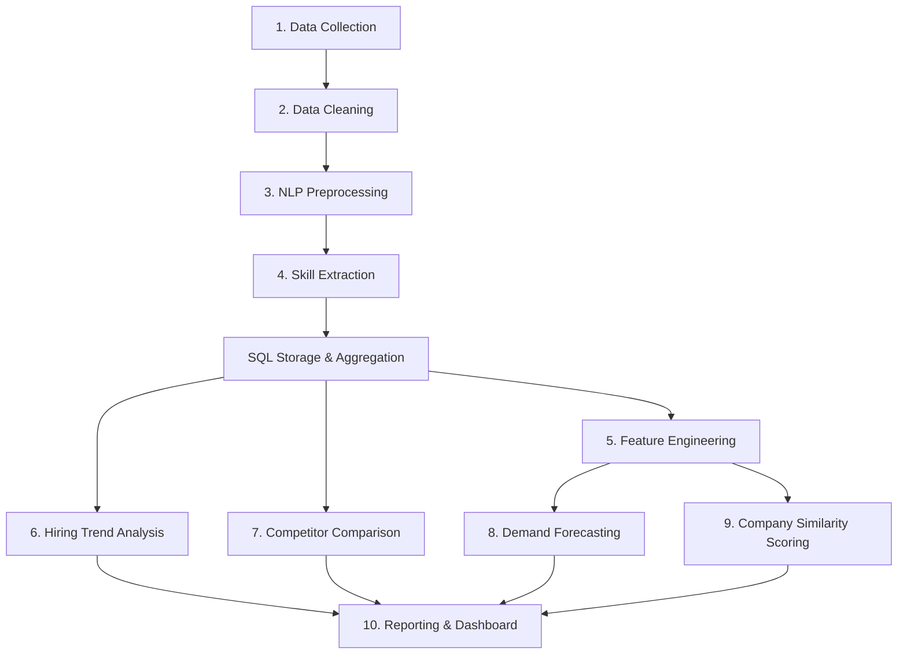

# Competitor Demand Prediction Using Job Postings

## Objective
This project aims to analyze and forecast competitor hiring demand and skill requirements using publicly available job posting data. By tracking job listing frequencies, extracting technical and soft skill sets, and modeling hiring patterns over time, the system enables organizations to anticipate competitor talent expansion, technological pivots, and workforce capacity trends.

### Target Scope
- **Target Company**: **Microsoft ONLY** (`company_name == "Microsoft"`)
- **Entity Definition**: Strict corporate entity matching; recruitment agencies, third-party staffing firms, and non-canonical subsidiaries are excluded.
- **Dataset Scale**: Exactly 498 validated Microsoft job postings spanning the full 2023 calendar year (52 out of 52 active ISO weeks).

---

## Technology Stack
- **Language**: Python (>= 3.9)
- **Data Manipulation & Math**: Pandas, NumPy
- **Machine Learning**: scikit-learn
- **Natural Language Processing**: NLTK, spaCy
- **Visualization**: Matplotlib
- **Database & Querying**: SQL (SQLite via `sqlite3` / SQLAlchemy)
- **Testing & Quality Assurance**: pytest
- **Reporting & Dashboard**: Streamlit / Python-driven reporting

---

## Data Source & Setup

The primary data source is the publicly available [Luke Barousse Data Jobs repository](https://github.com/lukebarousse/data_jobs).

> [!IMPORTANT]
> Raw and processed datasets are intentionally excluded from Git version control via `.gitignore` to keep the repository lightweight and adhere to best data engineering practices.

To configure the dataset locally:
1. Download `data_jobs.csv` from the source repository.
2. Place the file in the project directory at:
   ```text
   data/raw/data_jobs.csv
   ```
*(Optional NLP benchmark dataset `fake_job_postings.csv` can also be placed in `data/raw/` if utilizing text classification benchmarks).*

---

## Quickstart

### 1. Environment Setup
Clone the repository and set up a clean Python virtual environment:

```bash
# Windows
python -m venv venv
venv\Scripts\activate

# macOS / Linux
python3 -m venv venv
source venv/bin/activate
```

### 2. Install Dependencies
Install all required project and testing dependencies:

```bash
pip install -r requirements.txt
```

---

## Running Project Pipelines

All pipelines are designed to be executed directly from the repository root:

### Sprint 1: Data Ingestion & Target Filtering
Loads raw postings, filters strictly to Microsoft (`company_name == 'Microsoft'`), validates schema constraints (zero null titles, dates, or companies; exact 498 count), and exports the target slice:

```bash
python src/collection/collector.py
```
- **Input**: `data/raw/data_jobs.csv`
- **Output**: `data/processed/microsoft_jobs.csv` (498 records, 17 columns)
- **Validation Report**: `reports/dataset_validation_report.md`

### Sprint 2: Data Cleaning, Imputation & Date Normalization
Standardizes company casing, parses timestamps into 8 temporal attributes (year, month, week, day, day of week, quarter, year-week), annualizes compensation metrics, parses serialized skill arrays into structured lists/dictionaries, normalizes location hubs, and imputes missing categories:

```bash
python src/preprocessing/cleaner.py
```
- **Input**: `data/processed/microsoft_jobs.csv`
- **Output**: `data/processed/microsoft_jobs_cleaned.csv` (498 records, 32 columns)
- **Sprint Report**: `reports/sprint_02_report.md`

### Sprint 3: NLP Preprocessing Pipeline
Normalizes job title text, tokenizes and lemmatizes role terms, removes English and domain-specific stop-words (including seniority levels), preserves technical languages (C#, C++, SQL, Python), normalizes skill names with canonical aliases, deduplicates skills per job, and deserializes Sprint 2 skill lists back into Python objects for downstream analysis:

```bash
python src/preprocessing/nlp_pipeline.py
```
- **Input**: `data/processed/microsoft_jobs_cleaned.csv`
- **Output**: `data/processed/microsoft_jobs_nlp.csv` (498 records, 35 columns)
- **Sprint Report**: `reports/sprint_03_report.md`

---

## Running Automated Tests

The project includes unit tests for data collection, filtering, cleaning, salary annualization, skill parsing, location normalization, and NLP preprocessing (including C#/C++ regression tests). Run the test suite using `pytest`:

```bash
python -m pytest -v
```

All 87 unit tests across `tests/test_collector.py`, `tests/test_cleaner.py`, and `tests/test_nlp_pipeline.py` will run and validate the implementation.

---

## Project Stages & 12-Sprint Roadmap

1. **Sprint 1 — Data Collection**: Ingestion, strict competitor filtering, and validation (**Complete**).
2. **Sprint 2 — Data Cleaning**: Missing value imputation, date decomposition, salary standardization, and location parsing (**Complete**).
3. **Sprint 3 — NLP Preprocessing**: Text normalization, tokenization, lemmatization, and stop-word filtering across job titles and descriptions (**Complete**).
4. **Sprint 4 — Skill Extraction**: Extracting domain-specific technical skills, tools, and competencies using dictionary matching and NLP phrase extraction (*Pending*).
5. **Sprint 5 — Database Storage**: Relational SQLite schema design, index optimization, and data modeling (*Pending*).
6. **Sprint 6 — Feature Engineering**: Creating time-lag features, rolling averages, company-skill frequency matrices, and hiring velocity indicators (*Pending*).
7. **Sprint 7 — Hiring Trend Analysis**: Evaluating temporal hiring trends and volume dynamics across companies and job roles using SQL and Pandas (*Pending*).
8. **Sprint 8 — Competitor Comparison**: Benchmarking competitor profiles, tech stack overlap, and talent acquisition priorities (*Pending*).
9. **Sprint 9 — Demand Forecasting**: Building time-series and regression models (via scikit-learn) to predict future hiring demand by competitor and role (*Pending*).
10. **Sprint 10 — Company Similarity Scoring**: Computing vector similarity (e.g., Cosine Similarity) and clustering competitor profiles based on skill footprint and hiring distributions (*Pending*).
11. **Sprint 11 — Reporting / Dashboard**: Developing visual summaries, Matplotlib charts, and an interactive Streamlit dashboard (*Pending*).
12. **Sprint 12 — Integration & Final Review**: End-to-end pipeline validation, performance tuning, and executive presentation (*Pending*).

---

## Planned Workflow


---

## Project Directory Layout
```text
Competitor Demand Prediction Using Job Postings/
├── data/
│   ├── raw/                  # Raw unprocessed job postings (ignored by Git)
│   ├── processed/            # Cleaned and processed datasets (ignored by Git)
│   └── database/             # SQLite database files (ignored by Git)
├── sql/                      # SQL schema and analysis queries
│   ├── schema.sql
│   ├── competitor_queries.sql
│   └── trend_queries.sql
├── src/                      # Modular Python source code
│   ├── collection/           # Stage 1: Data collection & filtering
│   ├── preprocessing/        # Stages 2 & 3: Data cleaning & NLP pipeline
│   ├── skills/               # Stage 4: Skill extraction
│   ├── features/             # Stage 5: Feature engineering
│   ├── analysis/             # Stages 6 & 7: Trend analysis & competitor comparison
│   ├── modeling/             # Stages 8 & 9: Demand forecasting & company similarity
│   └── database/             # Database connection & querying utilities
├── dashboard/                # Stage 10: Interactive reporting dashboard
├── notebooks/                # Exploratory analysis & experiments
├── reports/                  # Generated visual reports and summaries
│   ├── dataset_validation_report.md
│   ├── sprint_02_report.md
│   ├── sprint_03_report.md
│   └── figures/
├── tests/                    # Automated test suite
│   ├── test_collector.py
│   ├── test_cleaner.py
│   └── test_nlp_pipeline.py
├── requirements.txt          # Python dependencies
└── README.md                 # Project documentation
```

---

## Status
- **Sprint 1 (Data Ingestion & Filtering)**: Completed & Validated (`reports/dataset_validation_report.md`).
- **Sprint 2 (Data Cleaning & Imputation)**: Completed & Validated (`reports/sprint_02_report.md`).
- **Sprint 3 (NLP Preprocessing Pipeline)**: Completed & Validated (`reports/sprint_03_report.md`).
- **Test Suite**: 67/67 passing (`python -m pytest -v`).
- **Upcoming Deliverable**: Sprint 4 (Skill Extraction).
